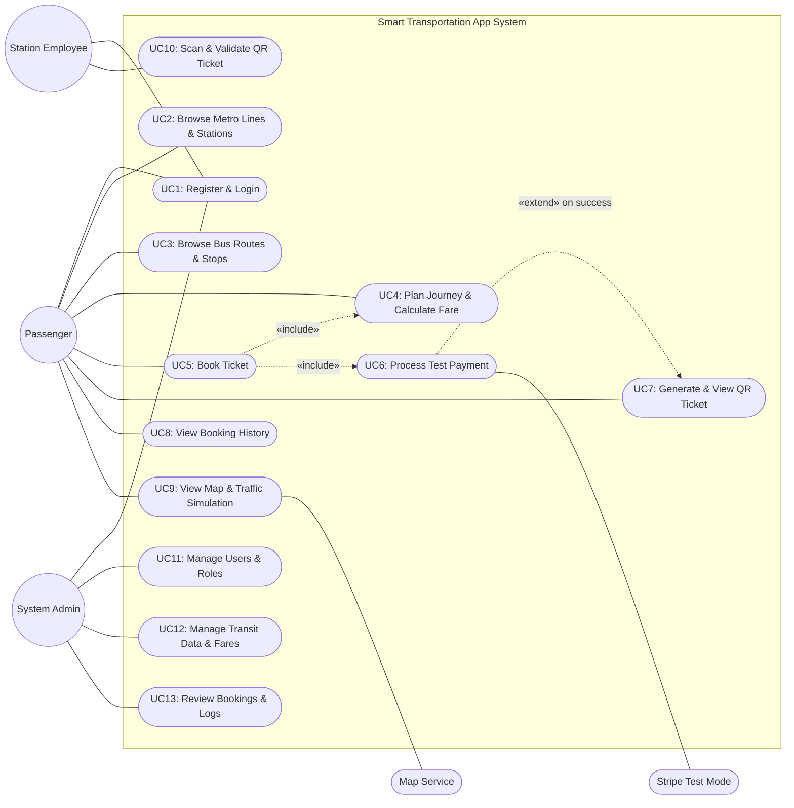
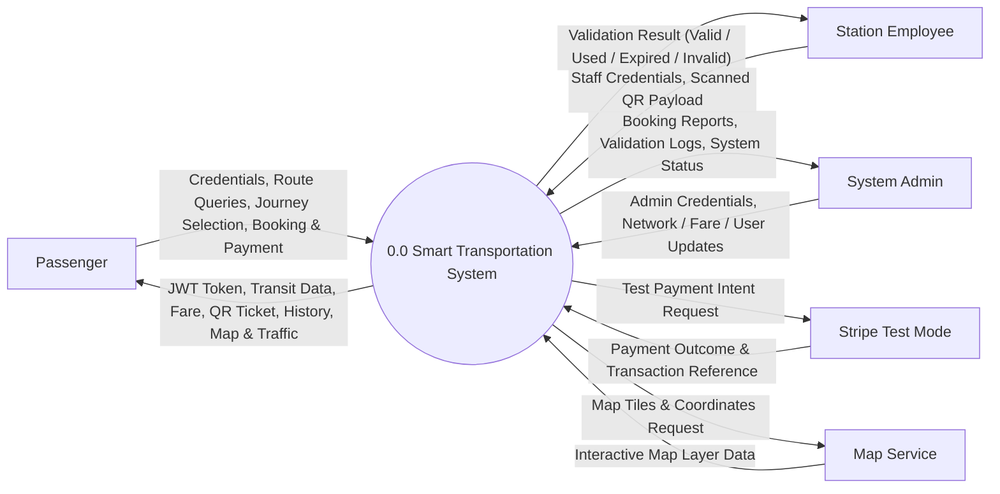
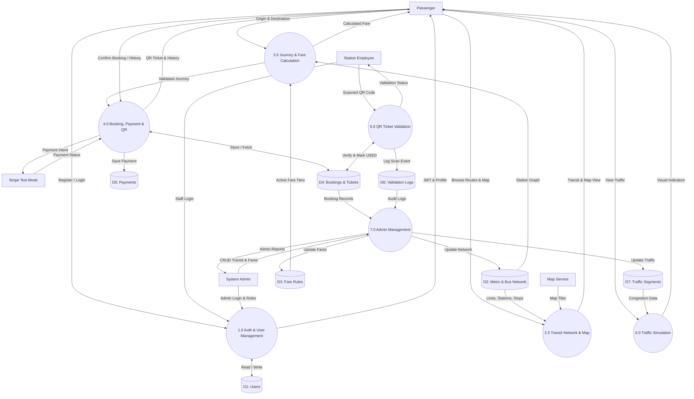
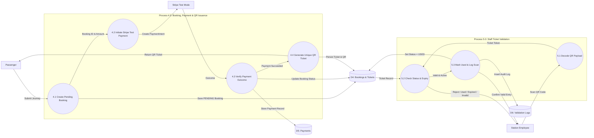
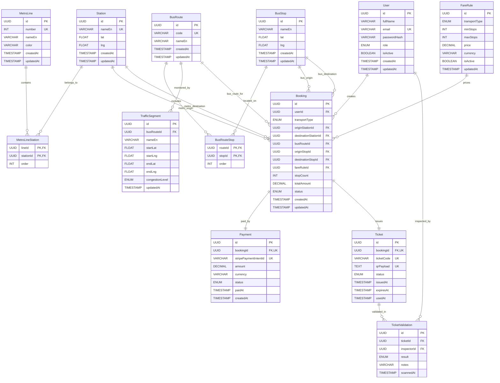
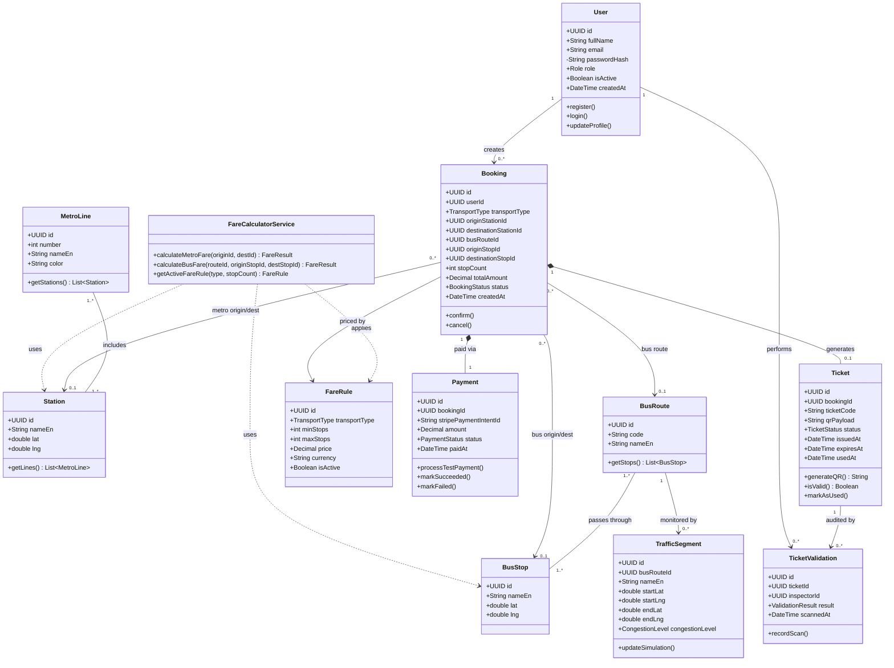
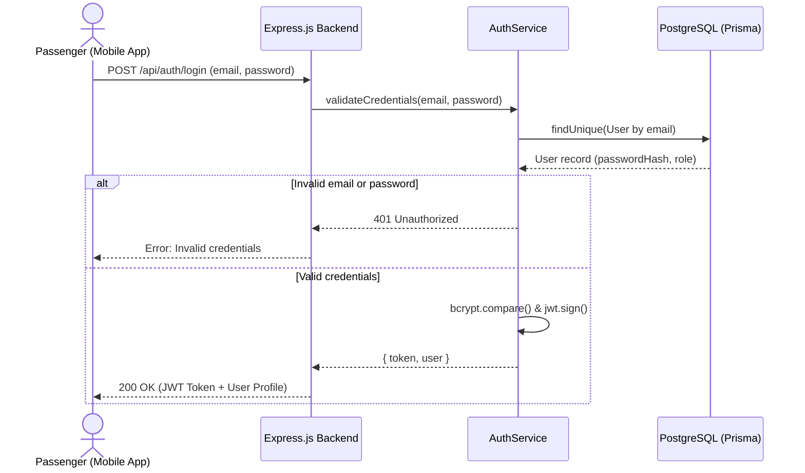
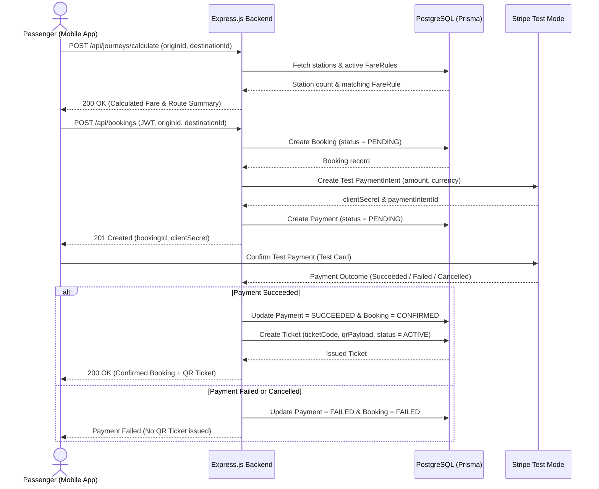
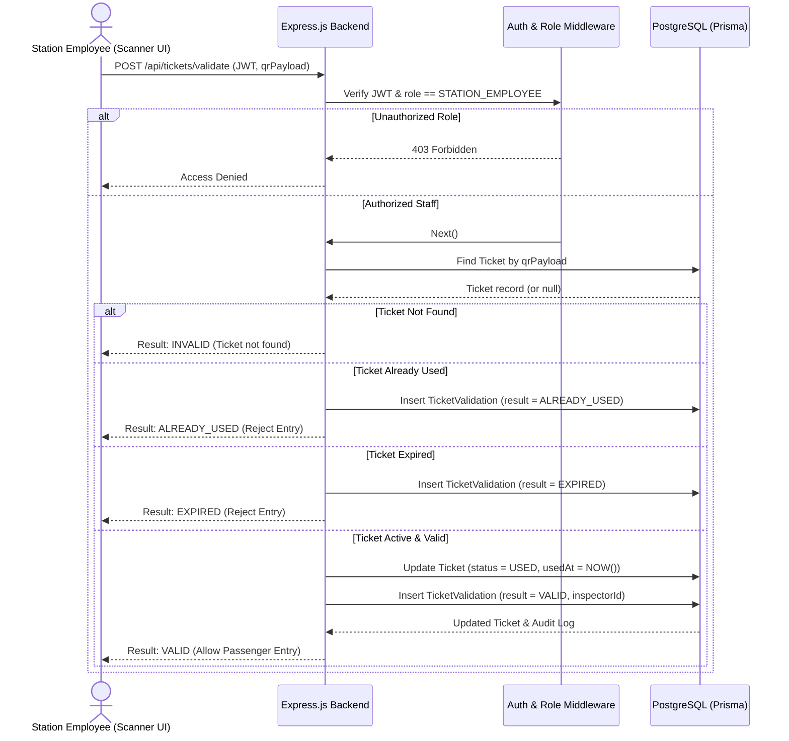

# Smart Transportation App — Graduation Project Documentation

> **Project Name:** Smart Transportation App  
> **Document Scope:** Complete Graduation Project Deliverable (Domain, Project Type, Problem Statement, Proposed Solution, Measurable Objectives, Initial Analysis, Use Case Diagram, DFD Levels 0/1/2, ERD, Physical Database Schema, and UML Class & Sequence Diagrams)  
> **Primary Sources:** Project Scope Document (`Project Objectives & Initial Analysis.docx`) and Implemented System Architecture (`React Native + Express.js + PostgreSQL / Prisma`).

---

## Table of Contents
1. [Domain / Sector](#1-domain--sector)
2. [Project Type](#2-project-type)
3. [Problem Statement](#3-problem-statement)
4. [Proposed Solution](#4-proposed-solution)
5. [Project Objectives](#5-project-objectives)
6. [Initial Analysis (Actors & Stakeholders)](#6-initial-analysis-actors--stakeholders)
7. [Use Case Diagram](#7-use-case-diagram)
8. [Data Flow Diagrams (DFD — Level 0, Level 1, Level 2)](#8-data-flow-diagrams-dfd--level-0-level-1-level-2)
9. [Entity Relationship Diagram (ERD)](#9-entity-relationship-diagram-erd)
10. [Physical Database Schema](#10-physical-database-schema)
11. [UML Diagrams (Class & Sequence Diagrams)](#11-uml-diagrams-class--sequence-diagrams)

---

## 1. Domain / Sector

* **Primary Domain:** **Smart Public Transportation & Urban Mobility**
* **Operational Scope:** Digitalization and simulation of urban public transit services, including metro lines and stations, bus routes and stops, automated fare calculation, electronic ticket booking, simulated digital payments, QR-based ticket issuance and station staff validation, interactive transit mapping, and visual traffic congestion simulation.

---

## 2. Project Type

The project is an **Integrated Mobile-First System (Mobile Application + RESTful Backend API + Cloud Relational Database)** composed of the following architectural layers:

| Layer / Component | Technology Stack | Responsibility |
| :--- | :--- | :--- |
| **Mobile Application** | **React Native (Expo)** | Cross-platform mobile client (Android / iOS) serving both Passengers and Station Employees. |
| **Backend API Server** | **Node.js + Express.js + TypeScript** | Centralized REST API handling JWT authentication, role-based access control (RBAC), transit data, fare calculation, bookings, payments, and QR ticket validation. |
| **Database** | **PostgreSQL (Neon) + Prisma ORM** | Persistent relational data store for users, metro lines/stations, bus routes/stops, fare rules, bookings, payments, tickets, validation logs, and traffic segments. |
| **Payment Simulation** | **Stripe Test Mode** | External payment sandbox simulating real-world checkout outcomes (succeeded, failed, cancelled) without real-money transactions. |
| **Digital Ticketing** | **QR Code Generation & Camera Scanner** | Unique QR code generation for issued tickets and camera-based staff scanning for instant verification. |
| **Map & Traffic View** | **Interactive Map + Congestion Simulation** | Visual map displaying metro stations, bus stops, routes, and simulated traffic congestion levels (Low, Moderate, High). |

---

## 3. Problem Statement

Commuters and public transportation operators face recurring operational and usability challenges in traditional transit workflows:

1. **Fragmented Transit Information:** Passengers lack a single, accessible digital source to explore metro lines, ordered stations, bus routes, and stops along with their geographic locations on an interactive map.
2. **Manual Fare Estimation & Journey Confusion:** Commuters—especially first-time riders—struggle to determine the number of stations between origin and destination and calculate the exact ticket price before arriving at the station.
3. **Ticket Counter Congestion & Paper Waste:** Relying on physical ticket booths causes long queues during peak hours, wastes commuter time, and introduces risks of lost, damaged, or duplicated paper tickets.
4. **Slow & Error-Prone Ticket Inspection:** Manual inspection of paper tickets by station staff is time-consuming and vulnerable to human error, making it difficult to prevent expired or already-used tickets from being reused.
5. **No Personal Booking History:** Passengers have no centralized record of their active tickets or past journeys.
6. **Limited Visibility into Traffic Conditions:** Commuters lack a visual reference showing simulated congestion levels across key road segments and transit corridors when planning their trips.

---

## 4. Proposed Solution

The **Smart Transportation App** solves these problems through an automated, role-based digital transit platform:

1. **Unified Metro & Bus Directory:** Stores and serves all configured metro lines, ordered stations, bus routes, and bus stops from a centralized `PostgreSQL` database through clean REST endpoints.
2. **Automated Journey Planning & Fare Calculation:** Passengers select an origin and destination station; the backend validates the selection (rejecting invalid or identical stations) and automatically calculates the fare according to configured `FareRule` tiers.
3. **Digital Ticket Booking & Simulated Payment:** Authenticated passengers book journeys and complete simulated payments via `Stripe Test Mode`. Payment outcomes automatically update booking and payment statuses—only succeeded payments issue valid tickets.
4. **Automated QR Ticket Generation & Staff Validation:** Every paid booking generates a unique ticket identifier and `QR Code`. Authorized Station Employees scan the QR code through a dedicated staff scanner interface; the backend verifies ticket authenticity, checks expiration/usage status, marks valid tickets as `USED`, and rejects duplicate or invalid scans.
5. **Interactive Map & Traffic Congestion Simulation:** Renders stations, bus stops, and routes on an interactive map alongside color-coded simulated traffic congestion indicators (`LOW`, `MODERATE`, `HIGH`).
6. **Role-Based Access Control (RBAC):** Enforces strict permission boundaries between `PASSENGER`, `STATION_EMPLOYEE`, and `ADMIN` roles using JWT authentication and middleware guards.

---

## 5. Project Objectives

The following 12 measurable objectives (`O1`–`O12`) define the direct outcomes of the project along with their verifiable acceptance indicators:

| ID | Objective | Description | Measurable Acceptance Indicator |
| :---: | :--- | :--- | :--- |
| **O1** | **User Registration & Authentication** | Provide account registration and login with credential validation and route protection. | A new user can register and log in with valid credentials; unauthenticated requests to protected features are blocked. |
| **O2** | **Display Metro Stations & Routes** | Allow users to browse available metro lines, stations, and ordered route details. | All metro lines and stations stored in the database are displayed in the mobile app associated with their correct lines. |
| **O3** | **Display Bus Routes** | Provide a clear view of configured bus routes and their associated stops. | Every configured bus route and its ordered stops can be opened and viewed by the user. |
| **O4** | **Journey Selection & Fare Calculation** | Allow passengers to choose origin and destination stations and receive the calculated fare. | Every supported origin-destination pair returns the correct fare per configured rules; invalid or identical selections are rejected with a clear message. |
| **O5** | **Book Tickets** | Allow authenticated passengers to create and persist ticket bookings. | A successful booking is stored in PostgreSQL linked to the passenger, journey, fare, status, and unique identifier. |
| **O6** | **Simulate Ticket Payment** | Integrate `Stripe Test Mode` to simulate checkout without real money. | A succeeded test payment updates booking/payment status to paid; failed or cancelled payments do not issue a paid ticket. |
| **O7** | **Generate QR Codes for Tickets** | Generate a unique QR code for each successfully issued ticket. | Every issued ticket has a QR code linked to its unique ticket record and readable by the staff scanner. |
| **O8** | **Validate Tickets via Staff Scanner** | Provide authorized station staff with a QR scanning interface to verify tickets. | The scanner accurately distinguishes valid, already-used, expired, and invalid tickets; already-used tickets are never accepted twice. |
| **O9** | **Interactive Transportation Map** | Display metro stations, bus stops, and routes on an interactive map. | Map markers and route representations render for configured transit data and respond to user inspection. |
| **O10** | **Simulate Traffic Congestion** | Present a visual simulation of varying traffic congestion across road segments. | The map/traffic view displays defined congestion states (`LOW`, `MODERATE`, `HIGH`) using distinguishable visual indicators. |
| **O11** | **View Current & Previous Bookings** | Allow passengers to view active tickets and historical bookings. | An authenticated passenger can view only their own bookings and ticket statuses; access to other passengers' records is denied. |
| **O12** | **Persistent Data Storage** | Use `PostgreSQL` as the central persistent store for all application records. | Core records persist across backend restarts, and all CRUD operations maintain relational consistency. |

---

## 6. Initial Analysis (Actors & Stakeholders)

### 6.1 System Actors

| Actor | Type | Main Responsibilities & Interactions | Permissions & Boundaries |
| :--- | :--- | :--- | :--- |
| **1. Passenger / End User** | Primary Human Actor | Register & log in; browse metro lines, stations, and bus routes; select origin/destination & view fare; book tickets & complete test payment; display QR tickets; review booking history; explore interactive map & traffic simulation. | Can access and manage only their own profile, bookings, and tickets. Cannot access staff scanning, other passengers' records, or admin controls. |
| **2. Station Employee / Ticket Inspector** | Operational Human Actor | Log in to staff scanner interface; scan passenger QR tickets; view real-time validation outcomes (Valid, Already Used, Expired, Invalid). | Restricted to authorized ticket validation operations. Cannot modify passenger accounts, payment records, or system configuration. |
| **3. System Administrator** | Administrative Human Actor | Manage user accounts and assigned roles; create, update, or delete metro lines, stations, bus routes, stops, and fare rules; review bookings and validation logs; monitor system operation. | Elevated administrative privileges restricted strictly to authorized `ADMIN` accounts. |
| **4. Stripe Test Mode** | External System | Receive simulated payment requests from the backend; return test outcomes (succeeded, failed, cancelled) and payment references. | External sandbox only; does not manage transit routes, user roles, or ticket inspection. |

### 6.2 Supporting External Systems & Components
* **Map Service / Map Data Provider:** Supplies map tiles and geographic rendering for station markers, bus stops, and routes.
* **QR Code & Camera Capability:** Technical capability for generating ticket QR codes and scanning them via mobile camera.
* **PostgreSQL Database (Neon):** Persistent relational database storing users, roles, transit network, fare rules, bookings, payments, tickets, and validation logs.

### 6.3 Stakeholders
1. **Passengers / Commuters:** Primary beneficiaries expecting accurate routes, transparent fares, smooth booking, and reliable QR ticket access.
2. **Station Operations / Transport Staff:** Directly affected by the QR inspection workflow; require fast scanning and unambiguous validation feedback.
3. **Transportation Operator / Authority:** Concerned with the accuracy of metro/bus routes, stops, and fare rules.
4. **System Owner / Project Sponsor:** Evaluates whether the delivered application satisfies functional scope, usability, and demonstration goals.
5. **Development Team:** Responsible for analysis, architecture, database design, implementation, testing, integration, and documentation.
6. **Payment Service Provider (Stripe):** Supplies the test payment infrastructure determining simulated payment outcomes.
7. **Map Data Provider:** Supplies map rendering services impacting map availability and visual fidelity.

---

## 7. Use Case Diagram

The Use Case Diagram below illustrates all interactions between human/external actors and the **Smart Transportation App System** (`UC1`–`UC13`), including `<<include>>` and `<<extend>>` relationships.

### Use Case Summary Table

| ID | Use Case | Primary Actor(s) | Goal Achieved |
| :---: | :--- | :--- | :--- |
| **UC1** | Register & Login | All Human Actors | Authenticate users and issue JWT tokens with role claims. |
| **UC2** | Browse Metro Lines & Stations | Passenger | Explore metro lines and their ordered stations. |
| **UC3** | Browse Bus Routes & Stops | Passenger | Explore bus routes and their ordered stops. |
| **UC4** | Plan Journey & Calculate Fare | Passenger | Select origin/destination stations and retrieve the exact fare. |
| **UC5** | Book Ticket | Passenger | Create a persisted ticket booking for a valid journey. |
| **UC6** | Process Test Payment | Passenger, Stripe | Complete simulated checkout via Stripe Test Mode. |
| **UC7** | Generate & View QR Ticket | Passenger | Issue and display a unique scannable QR ticket upon payment success. |
| **UC8** | View Booking History | Passenger | Inspect active tickets and past booking records. |
| **UC9** | View Map & Traffic Simulation | Passenger, Map Service | Inspect interactive station/route markers and congestion levels. |
| **UC10** | Scan & Validate QR Ticket | Station Employee | Verify QR ticket validity at stations and prevent duplicate usage. |
| **UC11** | Manage Users & Roles | System Admin | Create, update, activate/deactivate accounts and assign roles. |
| **UC12** | Manage Transit Data & Fares | System Admin | Maintain metro lines, stations, bus routes, stops, and fare rules. |
| **UC13** | Review Bookings & Logs | System Admin | Audit system bookings, payments, and ticket validation logs. |

---

## 8. Data Flow Diagrams (DFD — Level 0, Level 1, Level 2)

### 8.1 Context Diagram (Level 0 DFD)
Shows the entire system as a single top-level process (`0.0`) interacting with all external entities:

---

### 8.2 Level 1 DFD (System Decomposition)
Decomposes the system into 7 major processes (`1.0`–`7.0`) and 7 persistent data stores (`D1`–`D7`):

---

### 8.3 Level 2 DFD (Core Workflows: Booking/Payment & Ticket Validation)
Detailed breakdown of **Process 4.0 (Booking, Payment & QR Generation)** and **Process 5.0 (QR Ticket Validation)**:

---

## 9. Entity Relationship Diagram (ERD)

The ERD aligns directly with the implemented `Prisma` models (`User`, `MetroLine`, `Station`, `MetroLineStation`, `BusRoute`, `BusStop`, `BusRouteStop`) and completes the full business domain (`FareRule`, `Booking`, `Payment`, `Ticket`, `TicketValidation`, `TrafficSegment`).

### Key Relationship Cardinalities
* **Many-to-Many (M:N) resolved via Junction Tables:**
  * `MetroLine` ↔ `Station` via `MetroLineStation` (a line contains multiple stations; interchange stations belong to multiple lines; `order` preserves station sequence).
  * `BusRoute` ↔ `BusStop` via `BusRouteStop` (a route serves multiple stops; a stop may serve multiple routes; `order` preserves stop sequence).
* **Unified Metro & Bus Ticketing (One-to-Many — 1:N):**
  * `User` → `Booking` (one passenger can create many Metro or Bus bookings).
  * `Station` → `Booking` (for `METRO` bookings, links `originStationId` and `destinationStationId`).
  * `BusRoute` & `BusStop` → `Booking` (for `BUS` bookings, links `busRouteId`, `originStopId`, and `destinationStopId`).
  * `FareRule` → `Booking` (one fare tier—configured per `transportType` (`METRO` or `BUS`) and `minStops..maxStops`—prices many bookings).
  * `BusRoute` → `TrafficSegment` (road corridors along bus routes are linked to simulated traffic congestion segments).
  * `Ticket` → `TicketValidation` (a ticket can be scanned multiple times, e.g., first valid scan + subsequent rejected duplicate attempts).
  * `User` (Inspector) → `TicketValidation` (a station employee performs many validations).
* **One-to-One (1:1):**
  * `Booking` ↔ `Payment` (each Metro or Bus booking maps to one Stripe test payment record).
  * `Booking` ↔ `Ticket` (each confirmed booking issues one unique QR ticket).

---

## 10. Physical Database Schema

Translation of the ERD into physical **PostgreSQL** tables with **Primary Keys (PK)**, **Foreign Keys (FK)**, **Constraints**, and **Data Types**.

### 10.1 PostgreSQL ENUM Types
* `role_enum`: `'PASSENGER'`, `'STATION_EMPLOYEE'`, `'ADMIN'`
* `transport_type_enum`: `'METRO'`, `'BUS'`
* `booking_status_enum`: `'PENDING'`, `'CONFIRMED'`, `'CANCELLED'`, `'FAILED'`
* `payment_status_enum`: `'PENDING'`, `'SUCCEEDED'`, `'FAILED'`, `'CANCELLED'`
* `ticket_status_enum`: `'ACTIVE'`, `'USED'`, `'EXPIRED'`, `'REVOKED'`
* `validation_result_enum`: `'VALID'`, `'ALREADY_USED'`, `'EXPIRED'`, `'INVALID'`
* `congestion_level_enum`: `'LOW'`, `'MODERATE'`, `'HIGH'`

### 10.2 Physical Table Definitions

#### 1. `users`
| Column | Data Type | Constraints | Description |
| :--- | :--- | :--- | :--- |
| `id` | `UUID` | **PK**, `DEFAULT gen_random_uuid()` | Unique user identifier |
| `full_name` | `VARCHAR(120)` | `NOT NULL` | User full name |
| `email` | `VARCHAR(255)` | `UNIQUE`, `NOT NULL` | Login email address |
| `password_hash` | `TEXT` | `NOT NULL` | Bcrypt-hashed password |
| `role` | `role_enum` | `NOT NULL`, `DEFAULT 'PASSENGER'` | RBAC user role |
| `is_active` | `BOOLEAN` | `NOT NULL`, `DEFAULT TRUE` | Account active flag |
| `created_at` | `TIMESTAMPTZ` | `NOT NULL`, `DEFAULT NOW()` | Creation timestamp |
| `updated_at` | `TIMESTAMPTZ` | `NOT NULL`, `DEFAULT NOW()` | Last update timestamp |

#### 2. `metro_lines`
| Column | Data Type | Constraints | Description |
| :--- | :--- | :--- | :--- |
| `id` | `UUID` | **PK** | Unique metro line identifier |
| `number` | `INTEGER` | `UNIQUE`, `NOT NULL` | Metro line number (1, 2, 3...) |
| `name_en` | `VARCHAR(120)` | `NOT NULL` | Metro line name |
| `color` | `VARCHAR(20)` | `NOT NULL` | Hex color code for map rendering |
| `created_at` | `TIMESTAMPTZ` | `NOT NULL`, `DEFAULT NOW()` | Creation timestamp |
| `updated_at` | `TIMESTAMPTZ` | `NOT NULL`, `DEFAULT NOW()` | Last update timestamp |

#### 3. `stations`
| Column | Data Type | Constraints | Description |
| :--- | :--- | :--- | :--- |
| `id` | `UUID` | **PK** | Unique station identifier |
| `name_en` | `VARCHAR(150)` | `UNIQUE`, `NOT NULL` | Station name |
| `lat` | `DOUBLE PRECISION` | `NOT NULL` | Geographic latitude |
| `lng` | `DOUBLE PRECISION` | `NOT NULL` | Geographic longitude |
| `created_at` | `TIMESTAMPTZ` | `NOT NULL`, `DEFAULT NOW()` | Creation timestamp |
| `updated_at` | `TIMESTAMPTZ` | `NOT NULL`, `DEFAULT NOW()` | Last update timestamp |

#### 4. `metro_line_stations`
| Column | Data Type | Constraints | Description |
| :--- | :--- | :--- | :--- |
| `line_id` | `UUID` | **PK**, **FK** → `metro_lines(id)` `ON DELETE CASCADE` | Reference to metro line |
| `station_id` | `UUID` | **PK**, **FK** → `stations(id)` `ON DELETE CASCADE` | Reference to station |
| `order` | `INTEGER` | `NOT NULL`, `UNIQUE(line_id, order)` | Ordered position along the line |

#### 5. `bus_routes`
| Column | Data Type | Constraints | Description |
| :--- | :--- | :--- | :--- |
| `id` | `UUID` | **PK** | Unique bus route identifier |
| `code` | `VARCHAR(30)` | `UNIQUE`, `NOT NULL` | Bus route code / number |
| `name_en` | `VARCHAR(150)` | `NOT NULL` | Bus route name |
| `created_at` | `TIMESTAMPTZ` | `NOT NULL`, `DEFAULT NOW()` | Creation timestamp |
| `updated_at` | `TIMESTAMPTZ` | `NOT NULL`, `DEFAULT NOW()` | Last update timestamp |

#### 6. `bus_stops`
| Column | Data Type | Constraints | Description |
| :--- | :--- | :--- | :--- |
| `id` | `UUID` | **PK** | Unique bus stop identifier |
| `name_en` | `VARCHAR(150)` | `NOT NULL` | Bus stop name |
| `lat` | `DOUBLE PRECISION` | `NOT NULL` | Geographic latitude |
| `lng` | `DOUBLE PRECISION` | `NOT NULL` | Geographic longitude |
| `created_at` | `TIMESTAMPTZ` | `NOT NULL`, `DEFAULT NOW()` | Creation timestamp |
| `updated_at` | `TIMESTAMPTZ` | `NOT NULL`, `DEFAULT NOW()` | Last update timestamp |

#### 7. `bus_route_stops`
| Column | Data Type | Constraints | Description |
| :--- | :--- | :--- | :--- |
| `route_id` | `UUID` | **PK**, **FK** → `bus_routes(id)` `ON DELETE CASCADE` | Reference to bus route |
| `stop_id` | `UUID` | **PK**, **FK** → `bus_stops(id)` `ON DELETE CASCADE` | Reference to bus stop |
| `order` | `INTEGER` | `NOT NULL`, `UNIQUE(route_id, order)` | Ordered position along the route |

#### 8. `fare_rules`
| Column | Data Type | Constraints | Description |
| :--- | :--- | :--- | :--- |
| `id` | `UUID` | **PK** | Unique fare rule identifier |
| `transport_type` | `transport_type_enum` | `NOT NULL` | Transit mode (`METRO` or `BUS`) |
| `min_stops` | `INTEGER` | `NOT NULL`, `CHECK (>= 1)` | Minimum station/stop count for tier |
| `max_stops` | `INTEGER` | `NOT NULL`, `CHECK (>= min_stops)` | Maximum station/stop count for tier |
| `price` | `NUMERIC(10,2)` | `NOT NULL`, `CHECK (> 0)` | Ticket price (supports Metro & Bus tiers) |
| `currency` | `VARCHAR(10)` | `NOT NULL`, `DEFAULT 'EGP'` | Currency code |
| `is_active` | `BOOLEAN` | `NOT NULL`, `DEFAULT TRUE` | Active fare tier flag |
| `updated_at` | `TIMESTAMPTZ` | `NOT NULL`, `DEFAULT NOW()` | Last update timestamp |

#### 9. `bookings`
| Column | Data Type | Constraints | Description |
| :--- | :--- | :--- | :--- |
| `id` | `UUID` | **PK** | Unique booking identifier |
| `user_id` | `UUID` | **FK** → `users(id)`, `NOT NULL` | Passenger who created the booking |
| `transport_type` | `transport_type_enum` | `NOT NULL` | Mode booked (`METRO` or `BUS`) |
| `origin_station_id` | `UUID` | **FK** → `stations(id)`, `NULL` | Metro departure station (required when `METRO`) |
| `destination_station_id` | `UUID` | **FK** → `stations(id)`, `NULL` | Metro arrival station (required when `METRO`) |
| `bus_route_id` | `UUID` | **FK** → `bus_routes(id)`, `NULL` | Selected bus route (required when `BUS`) |
| `origin_stop_id` | `UUID` | **FK** → `bus_stops(id)`, `NULL` | Bus boarding stop (required when `BUS`) |
| `destination_stop_id` | `UUID` | **FK** → `bus_stops(id)`, `NULL` | Bus alighting stop (required when `BUS`) |
| `fare_rule_id` | `UUID` | **FK** → `fare_rules(id)`, `NOT NULL` | Applied Metro or Bus fare rule |
| `stop_count` | `INTEGER` | `NOT NULL`, `CHECK (> 0)` | Computed stations (Metro) or stops (Bus) |
| `total_amount` | `NUMERIC(10,2)` | `NOT NULL` | Total ticket fare |
| `status` | `booking_status_enum` | `NOT NULL`, `DEFAULT 'PENDING'` | Current booking status |
| `created_at` | `TIMESTAMPTZ` | `NOT NULL`, `DEFAULT NOW()` | Booking creation timestamp |
| `updated_at` | `TIMESTAMPTZ` | `NOT NULL`, `DEFAULT NOW()` | Last update timestamp |

#### 10. `payments`
| Column | Data Type | Constraints | Description |
| :--- | :--- | :--- | :--- |
| `id` | `UUID` | **PK** | Unique payment identifier |
| `booking_id` | `UUID` | **FK** → `bookings(id)`, `UNIQUE`, `NOT NULL` | Associated booking (1:1) |
| `stripe_payment_intent_id` | `VARCHAR(255)` | `UNIQUE`, `NOT NULL` | Stripe Test Mode payment reference |
| `amount` | `NUMERIC(10,2)` | `NOT NULL` | Paid amount |
| `currency` | `VARCHAR(10)` | `NOT NULL`, `DEFAULT 'EGP'` | Currency code |
| `status` | `payment_status_enum` | `NOT NULL`, `DEFAULT 'PENDING'` | Simulated payment status |
| `paid_at` | `TIMESTAMPTZ` | `NULL` | Timestamp when payment succeeded |
| `created_at` | `TIMESTAMPTZ` | `NOT NULL`, `DEFAULT NOW()` | Record creation timestamp |

#### 11. `tickets`
| Column | Data Type | Constraints | Description |
| :--- | :--- | :--- | :--- |
| `id` | `UUID` | **PK** | Unique ticket identifier |
| `booking_id` | `UUID` | **FK** → `bookings(id)`, `UNIQUE`, `NOT NULL` | Associated booking (1:1) |
| `ticket_code` | `VARCHAR(64)` | `UNIQUE`, `NOT NULL` | Human-readable unique ticket code |
| `qr_payload` | `TEXT` | `UNIQUE`, `NOT NULL` | Signed/encoded QR token payload |
| `status` | `ticket_status_enum` | `NOT NULL`, `DEFAULT 'ACTIVE'` | Ticket lifecycle status |
| `issued_at` | `TIMESTAMPTZ` | `NOT NULL`, `DEFAULT NOW()` | Issuance timestamp |
| `expires_at` | `TIMESTAMPTZ` | `NOT NULL` | Expiration timestamp |
| `used_at` | `TIMESTAMPTZ` | `NULL` | Timestamp when scanned as valid |

#### 12. `ticket_validations`
| Column | Data Type | Constraints | Description |
| :--- | :--- | :--- | :--- |
| `id` | `UUID` | **PK** | Unique validation log identifier |
| `ticket_id` | `UUID` | **FK** → `tickets(id)`, `NOT NULL` | Scanned ticket reference |
| `inspector_id` | `UUID` | **FK** → `users(id)`, `NOT NULL` | Station employee who performed scan |
| `result` | `validation_result_enum` | `NOT NULL` | Outcome (`VALID`, `ALREADY_USED`, `EXPIRED`, `INVALID`) |
| `notes` | `VARCHAR(255)` | `NULL` | Optional inspection notes |
| `scanned_at` | `TIMESTAMPTZ` | `NOT NULL`, `DEFAULT NOW()` | Scan timestamp |

#### 13. `traffic_segments`
| Column | Data Type | Constraints | Description |
| :--- | :--- | :--- | :--- |
| `id` | `UUID` | **PK** | Unique traffic segment identifier |
| `bus_route_id` | `UUID` | **FK** → `bus_routes(id)`, `NULL` | Bus corridor affected by this traffic segment |
| `name_en` | `VARCHAR(150)` | `NOT NULL` | Corridor / road segment name |
| `start_lat` | `DOUBLE PRECISION` | `NOT NULL` | Segment start latitude |
| `start_lng` | `DOUBLE PRECISION` | `NOT NULL` | Segment start longitude |
| `end_lat` | `DOUBLE PRECISION` | `NOT NULL` | Segment end latitude |
| `end_lng` | `DOUBLE PRECISION` | `NOT NULL` | Segment end longitude |
| `congestion_level` | `congestion_level_enum` | `NOT NULL` | Simulated state (`LOW`, `MODERATE`, `HIGH`) |
| `updated_at` | `TIMESTAMPTZ` | `NOT NULL`, `DEFAULT NOW()` | Last simulation update |

---

## 11. UML Diagrams (Class & Sequence Diagrams)

### 11.1 UML Class Diagram
Illustrates the core domain classes, service layer, attributes, methods, and object-oriented relationships:

---

### 11.2 UML Sequence Diagrams

#### Sequence Diagram 1: User Authentication (Login Flow)

---

#### Sequence Diagram 2: Journey Selection, Fare Calculation, Booking, Stripe Test Payment & QR Generation

---

#### Sequence Diagram 3: Station Staff QR Ticket Scanning & Validation Flow

